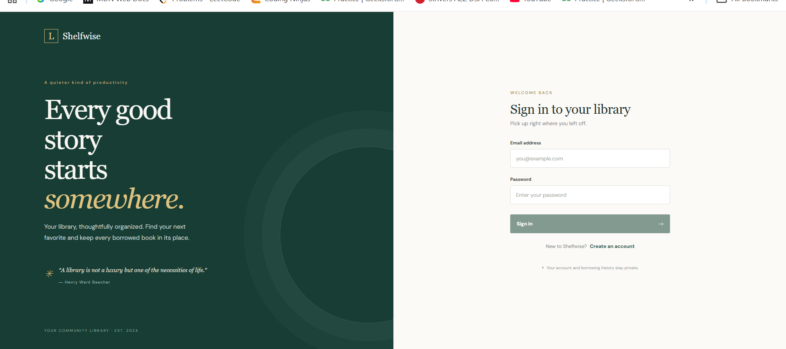
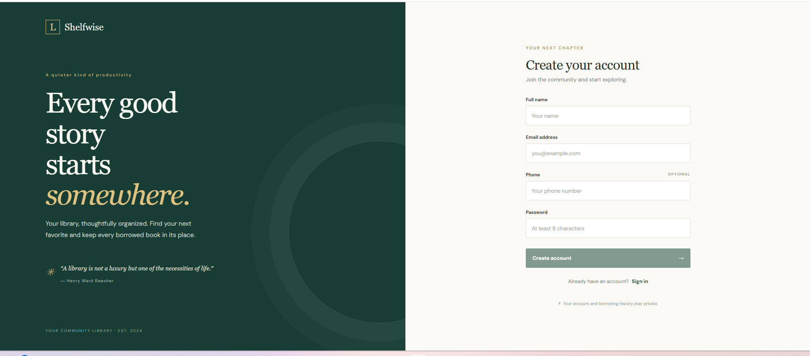
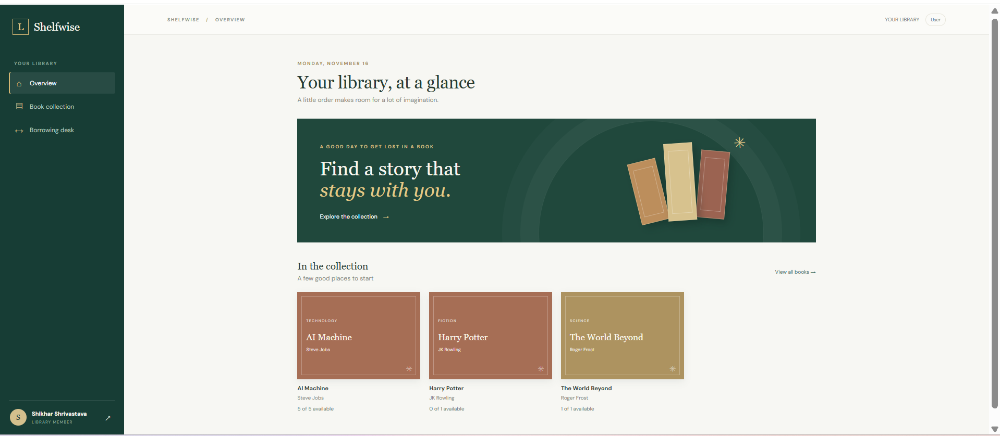
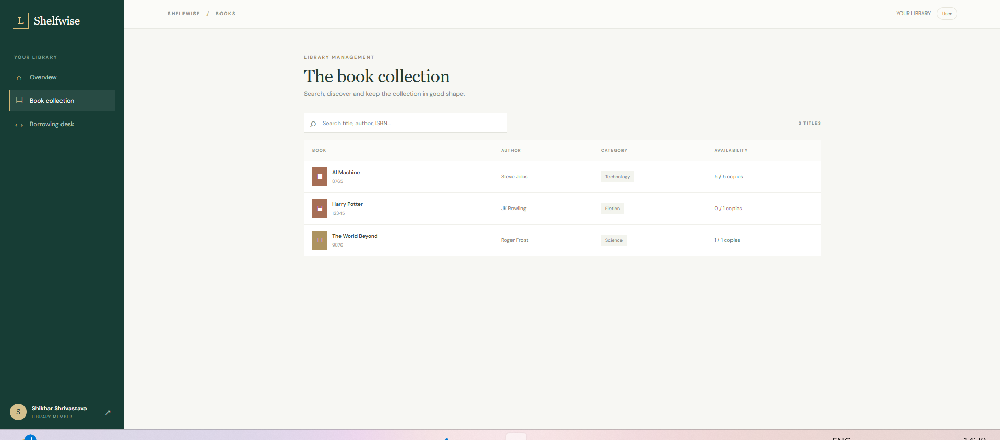
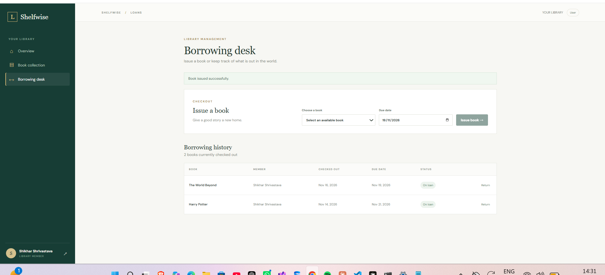
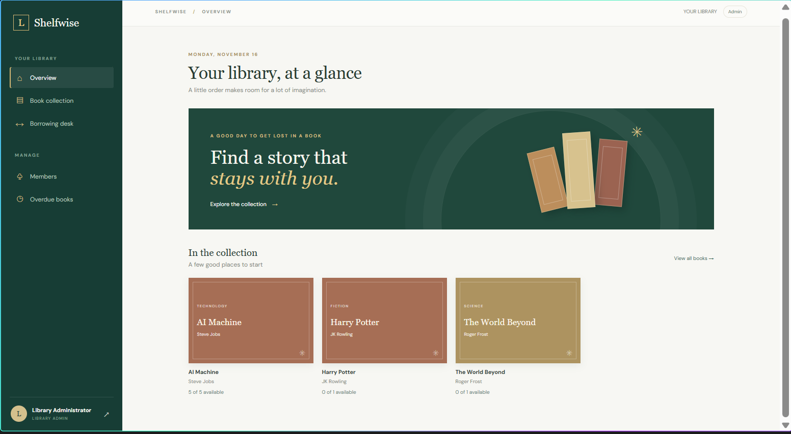
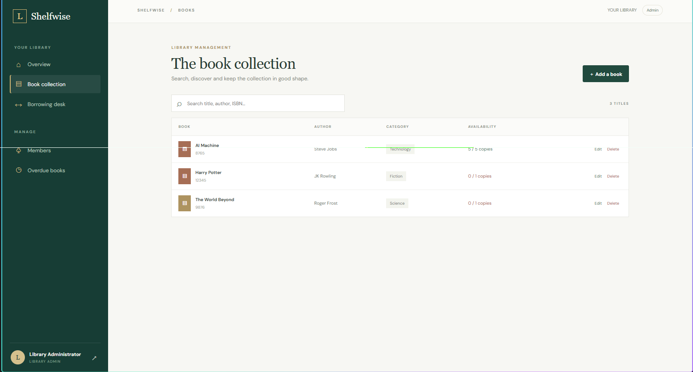
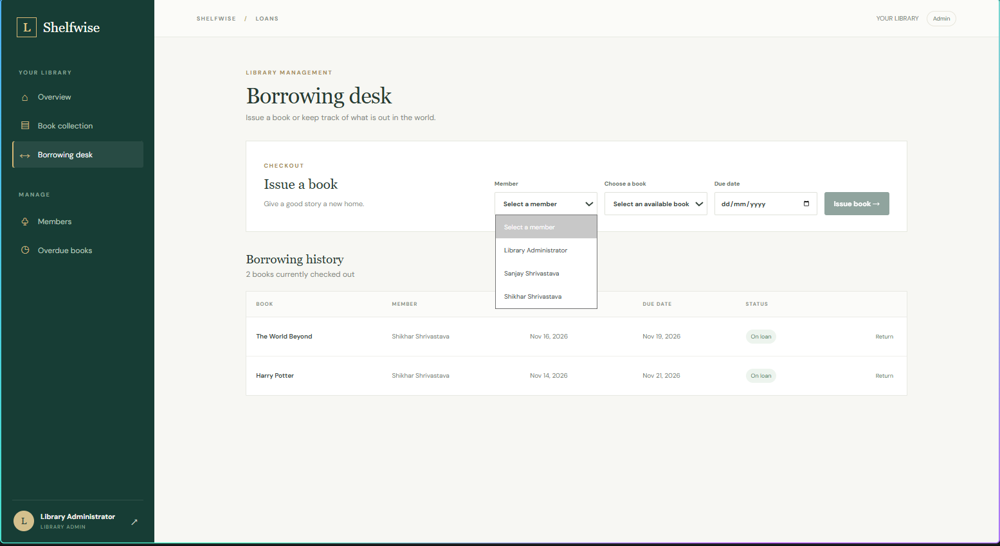
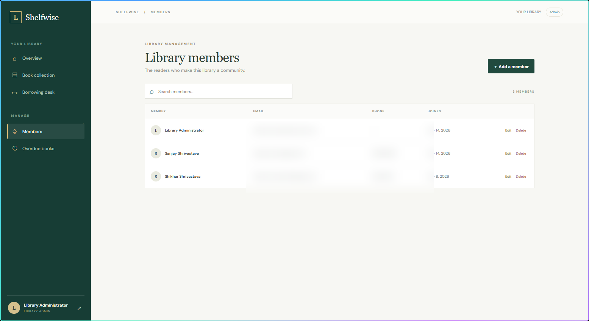

# Shelfwise – Library Management System

A full-stack library management application built with **Angular**, **ASP.NET Core Web API**, **Entity Framework Core**, and **SQL Server**. Shelfwise provides separate experiences for library members and administrators to manage books and borrowing activity.

## Screenshots

The screenshots below show the application’s authentication flow, member experience, and administrator workspace. The application is demonstrated locally; a public live demo is not currently available.

### 1. Authentication

| Sign in | Create an account |
|---|---|
|  |  |

### 2. Member experience

Members can browse the library, search the collection, check availability, and view their borrowing activity.

**Overview**



**Book collection**



**Borrowing desk and borrowing history**



### 3. Administrator workspace

Administrators have access to management screens for the catalogue, borrowing activity, and library members.

**Admin overview**



**Book management**



**Borrowing management**



**Member management**



## Features

### Member
- Register and sign in to a personal library account.
- Browse and search the book catalogue.
- View book details and copy availability.
- Issue available books and view borrowing history.
- Return eligible borrowed books.

### Administrator
- Access protected administrator functionality.
- Add, edit, and delete books.
- Search and manage library members.
- Issue books to members and record returns.
- Review borrowing activity and overdue books.

### Application and security
- JWT-based authentication with expiring tokens.
- BCrypt password hashing.
- Role-based authorization for Admin and User accounts.
- Protected Angular routes and an HTTP interceptor for bearer tokens.
- Inventory updates and copy-count validation during checkout and return.
- SQL Server constraints and stored-procedure-backed overdue tracking.

## Technology stack

| Layer | Technologies |
|---|---|
| Frontend | Angular, TypeScript |
| Backend | ASP.NET Core Web API, C# |
| ORM / Data access | Entity Framework Core |
| Database | Microsoft SQL Server |
| Authentication | JWT, BCrypt |
| API style | REST |

## Project structure

```text
Library-Management-System/
├── Backend/
│   └── LibraryApi/             # ASP.NET Core Web API
├── Frontend/
│   └── library-ui/              # Angular application
├── database/
│   ├── schema.sql               # SQL Server schema reference
│   ├── stored-procedures.sql    # Stored procedure reference
│   └── seed.sql                 # Optional sample catalogue
└── README.md
```

## Run locally

### Prerequisites

- .NET 10 SDK
- Node.js 20.19+ (Node 24 recommended) and npm
- SQL Server (Developer, Express, Standard, or another reachable SQL Server instance)
- SQL Server Management Studio (SSMS) is recommended for database administration

### 1. Clone the repository

```bash
git clone https://github.com/shikharshri2002/Library-Management-System.git
cd Library-Management-System
```

### 2. Configure SQL Server

Create an empty database named `LibraryManagement` in SQL Server Management Studio.

Set the connection string in PowerShell. Replace the server and instance with the values shown in SSMS:

```powershell
$env:ConnectionStrings__LibraryDatabase = "Server=YOUR_SERVER\YOUR_INSTANCE;Database=LibraryManagement;Trusted_Connection=True;TrustServerCertificate=True"
```

For SQL Server Authentication, keep credentials out of source control and provide the connection string through environment variables instead.

The API applies Entity Framework Core migrations at startup. The configured SQL Server login must have the permissions required to connect to the database and create or update its schema.

### 3. Configure authentication and create the first administrator

Set the bootstrap administrator credentials and a private JWT signing key in the same PowerShell session:

```powershell
$env:BootstrapAdmin__Email = "admin@example.com"
$env:BootstrapAdmin__Password = "choose-a-long-unique-password"
$env:Jwt__Key = "replace-with-a-private-secret-at-least-32-bytes-long"
```

Run the backend:

```powershell
dotnet run --project .\Backend\LibraryApi
```

The bootstrap administrator is created only if the configured email does not already exist. Public registration creates a regular User account, not an administrator.

**Security note:** Use a unique, private JWT key and strong administrator password. Do not commit credentials, connection strings containing passwords, or production secrets to GitHub. The development JWT key in local configuration is not suitable for production.

### 4. Run the Angular frontend

Open a second PowerShell terminal:

```powershell
Set-Location .\Frontend\library-ui
npm install
npm start
```

Open the frontend at:

```text
http://localhost:4200
```

The API's HTTP launch profile listens at:

```text
http://localhost:5160
```

The frontend API base URL is configured as `http://localhost:5160/api`. If you use a different frontend origin, add it to the API's `AllowedOrigins` configuration.

## Database notes

- Entity Framework Core migrations create and update the application schema when the API starts.
- `database/schema.sql` is a reference for the SQL Server schema; do not run it against a database already managed by the API migrations.
- The initial migration installs the overdue-books stored procedure.
- `database/seed.sql` contains optional sample catalogue data for a database initialized by the API.

## Main API routes

| Method | Endpoint | Access |
|---|---|---|
| POST | `/api/auth/register` | Public |
| POST | `/api/auth/login` | Public |
| GET | `/api/books?search=` | Authenticated |
| POST, PUT, DELETE | `/api/books` | Admin |
| GET, POST, PUT, DELETE | `/api/members` | Admin |
| GET, POST | `/api/borrowing` | Authenticated |
| POST | `/api/borrowing/{id}/return` | Record owner or Admin |
| GET | `/api/borrowing/overdue` | Admin |

## Future improvements

- Deploy the frontend, API, and database to a cloud hosting environment.
- Add a public demo environment with safe sample data.
- Add automated tests for critical borrowing and authorization workflows.

## Author

**Shikhar Shrivastava**

- GitHub: [@shikharshri2002](https://github.com/shikharshri2002)
- Project repository: [Library-Management-System](https://github.com/shikharshri2002/Library-Management-System)
